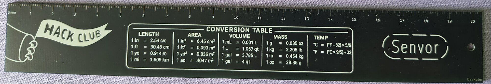
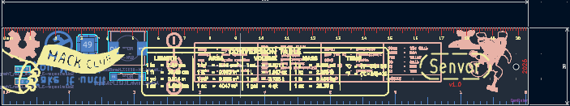
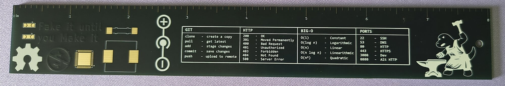

<div align="center">

# DevRuler

**A custom PCB ruler for developers to show off their identity without saying a word.**

A ruler made out of a circuit board, with hardware footprints, everyday commands and SI unit conversions printed right on it.




</div>

---

## What is it?

It's an everyday-use ruler designed specifically for developers. I packed it with some cool stuff:

- **Hardware footprints** for quick sizing and idk, all the footprints are random.
- **Daily use commands** for the moments when your brain completely blanks on basic commands.
- **Basic SI unit conversions** so you never have to Google them again.
- **Sweet branding** from [Hack Club](https://hackclub.com/) and their awesome hardware program, [Forge](https://forge.hackclub.com/)!

## Why I Built It

I have always loved watching hardware videos on YouTube, and one day I found a video showcasing a PCB ruler. I was instantly obsessed with the idea and decided to make my own custom PCB ruler.

I started searching for a good Hack Club program to make it in, and after a while I found Forge, a really cool hardware-only HC program, and started working on my project.

## The PCB Design

I designed the entire board from scratch using **KiCad**.

<div align="center">
  
  <br/>
  <i>A look at the raw KiCad layout.</i>
</div>

## Fabrication (JLCPCB)

Here's the final manufacturing quote and preview from JLCPCB before it became reality:

<div align="center">
  
</div>

## It Arrived!

The boards showed up from JLCPCB and they look great.

| Front | Back |
|:---:|:---:|
|  |  |

## Bill Of Materials

Also in [BOM.csv](BOM.csv).

| Category | Item Name | Description | Delivery (estimated) | Vendor | Quantity | Total Price (USD) |
|---|---|---|---:|---|---:|---:|
| PCB | DevRuler | The coolest Ruler OAT | $9.92 | JLCPCB | 5 | $28.32 |

## Tech Stack

- **KiCad** - schematic and PCB design
- **JLCPCB** - PCB fabrication

## Project Structure

```
DevRuler/
├── pcb/              # KiCad project, schematic and PCB
├── output files/     # fabrication outputs (DevRuler.zip)
├── assets/           # README images
└── BOM.csv           # bill of materials
```

## License

This project is licensed under the [MIT License](LICENSE). You're free to use, modify, and share it, as long as the original copyright notice is kept.
